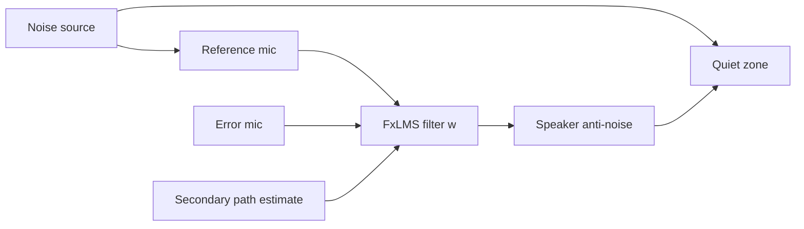

# Architecture

Feedforward active noise cancellation (ANC) on Raspberry Pi 4 using **Filtered-x LMS (FxLMS)**. Two I2S microphones share a stereo capture bus; a Google Voice HAT drives the anti-noise speaker.

## Signal flow

1. **Reference** `x(n)` — noise correlated with what reaches the error mic.
2. **Error** `e(n)` — residual at the listening position (what you want minimized).
3. **Secondary path** `ŝ` — FIR from speaker output to error mic (offline calibration).
4. **Control** `y(n) = w^T x_f(n)` — anti-noise; filtered regressor `x_f` uses `ŝ` (FxLMS).

The adaptive filter `w` is updated only after `warmup_seconds` so transients do not destabilize adaptation.

## Repository layout

| Path | Role |
|------|------|
| `anc/run_anc.py` | Main FxLMS loop, watchdog, graceful shutdown |
| `anc/dsp.py` | `FxLMSFilter`, MLS probe, cross-correlation, LS FIR fit |
| `anc/audio_io.py` | ALSA duplex via `python3-alsaaudio` when available |
| `anc/audio_io_subprocess.py` | `arecord`/`aplayer` fallback (higher latency) |
| `anc/config_load.py` | Load `config.yaml`, resolve paths under `anc/` |
| `anc/monitor.py` | RMS levels per channel (channel map check) |
| `anc/measure_delay.py` | Acoustic delay ref → error → `ref_to_error_delay` |
| `anc/calibrate_secondary.py` | MLS through speaker → `data/secondary_path.npz` |
| `anc/config.yaml` | Hardware and algorithm parameters |
| `scripts/deploy.sh` | Rsync `anc/` to the Pi and install venv |
| `scripts/anc.service` | systemd unit for unattended operation |

## Runtime loop (`run_anc.py`)

Each block (default 512 samples @ 48 kHz ≈ 10.7 ms):

1. `DuplexAudio.read_block()` — split stereo capture into reference and error vectors.
2. `FxLMSFilter.process_block()` — optional adaptation; returns speaker signal and error RMS.
3. Apply `invert_output`, zero output during warmup, clamp with `max_output`.
4. `DuplexAudio.write_output()` — mono anti-noise to playback channels.
5. `Watchdog.update()` — if error RMS stays above baseline × factor, halve `mu` (down to `mu_min`).

On SIGINT/SIGTERM or exit, playback is zeroed before closing ALSA.

## Watchdog

After `watchdog_baseline_seconds`, the first error RMS becomes the baseline. If RMS exceeds `baseline × watchdog_factor` for `watchdog_duration_seconds`, step size is reduced. When RMS is healthy again, `mu` slowly recovers toward the configured value (capped at `base_mu`).

## Prerequisites on the Pi

- `config.txt`: `dtoverlay=googlevoicehat-soundcard`, `dtparam=i2s=on`
- ALSA device `hw:1,0` (adjust `device` in config if card order differs)
- `python3-alsaaudio` strongly recommended for stable duplex timing

See [CONFIGURATION.md](CONFIGURATION.md) for every `config.yaml` key and [DEVELOPMENT.md](DEVELOPMENT.md) for deploy and local workflow.